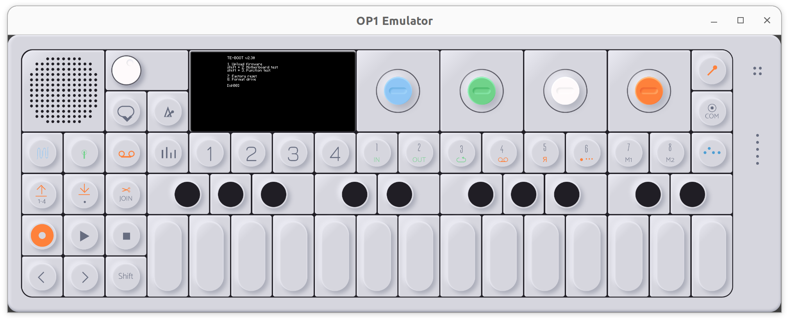

# OP-1 Emulator

An emulator for the Teenage Engineering OP-1 synthesizer.
Still work in progress.

Test with op1_246.op1/te-boot.ldr



## Building

```bash
git clone https://github.com/op1emu/op1emu.git
cd op1emu
git submodule update --init --recursive

mkdir build
cmake -B build -GNinja
cmake --build build
./build/op1emu path/to/nandflash.img path/to/te-boot.ldr
```

## Headless operation

Run from the repository root with the matching `otp.bin`:

```bash
./build/op1emu nand.bin --nand-snapshot --headless
```

No GLFW initialization, window, OpenGL rendering, or host audio device is
started. The existing executable still links GLFW/OpenGL and needs their build
dependencies. PPI/DMA, SPORT sample timing, frame-sync callbacks, USB/IP, and CPU
execution continue. The main loop retains its 16 ms sleep, random accelerometer
feed, and midpoint volume unless a script sets them (see below). Nothing is
drawn and host audio output is discarded, but the last complete frame is kept
so scripts can wait for and capture it.

Enter one command per line on stdin (press Enter in a terminal):

```text
keys
tap synth
press shift
tap play 200
release shift
quit
```

`keys` lists the button names from `gui/ui.json`, including `play`, `stop`,
`shift`, `c4`, `f3#`, and encoder **push** buttons `enc1` through `enc4`.
`press KEY` holds a key until `release KEY`; use these for chords.
`tap KEY [MS]` holds and releases it (default 100 ms).
`wait MS` delays subsequent commands while emulation continues.
Durations are integer wall-clock milliseconds, from 1 to 86400000, serviced at
the host loop cadence. They are not deterministic guest-cycle timestamps;
short presses can be missed while firmware is busy compiling or booting.
Explicit press/release pairs need a wait between them to be observable by firmware.

Instead of guessing how long the firmware needs, wait for the screen and look at it:

- `wait-frames N [TIMEOUT_MS]` holds later commands until N *new* complete frames
  have been drawn (a frame starts at pixel (0,0) and must cover the whole panel).
  The default timeout is 600000 ms; on timeout the emulator reports an error and
  exits nonzero rather than hanging. During boot the firmware shows the logo and
  then draws nothing for a long time (about two minutes on a desktop CPU, mostly
  JIT compilation), so give the first wait a generous timeout.
- `screenshot PATH` writes the latest complete frame as a binary PPM (P6), rotated
  to the landscape orientation the GUI shows (400x200). It is an error if no
  complete frame exists yet. Paths cannot contain spaces. Convert with e.g.
  `convert shot.ppm shot.png`.

A frame appearing does not mean the firmware is ready for input. A 100 ms tap sent
the moment the main screen first appeared was ignored; after a further
`wait 5000`, `tap synth 500`, `tap drum 500` and `tap play 500` each switched the
screen. Compare screenshots taken before and after a key to see whether it was handled.

Sensors are fed by the host loop, not the firmware. By default acceleration is
random on every 16 ms tick, which makes the interrupt load (and so runs) vary
from run to run. A script can pin them:

- `accel X Y Z` fixes the accelerometer (int16 each) and sends it once;
  `accel random` goes back to the random feed.
- `volume N` (0..255, default 128) sets the volume knob.

For a repeatable run put `accel 64 -64 512` on the first line of an input script;
it is applied before the first sample is sent. Commands typed on stdin later cannot
undo samples already delivered.

For replay, save the following as `keys.txt` and pass
`--headless --input-script keys.txt`:

```text
accel 64 -64 512
# Wait until the firmware has drawn the logo, then until the main screen is up
# (the frame counts are a heuristic; the firmware needs a few more seconds).
wait-frames 1 300000
wait-frames 20 900000
wait 5000
screenshot before.ppm
tap synth 500
wait 3000
screenshot after.ppm
quit
```

Scripts and stdin use the same commands. Blank lines and lines beginning with
`#` are ignored. EOF leaves the emulator running, including any pending tap
release; `quit`, SIGINT, or SIGTERM requests clean shutdown. Invalid commands
report an error and exit nonzero, as does a JIT/execution failure in the CPU
thread (previously the emulator would retry forever). Log lines say when input was **queued**, not
when firmware handled it. NAND writes are persistent unless `--nand-snapshot` is
selected. When comparing timings, use the same frontend mode for every run:
removing GL swaps and host audio changes host overhead and frame cadence.

## Guest time

Guest time comes from what the core executed: one cycle per instruction packet
at 400 MHz (an issue model with no pipeline, cache or PLL timing), plus the
cycles an IDLE waits. CYCLES, the core timer, the GP timers, SPORT sample pacing,
the panel's frame sync and the RTC all follow it.

- The core timer runs at its programmed rate.
- SPORT moves frames at the codec's 44.1 kHz, the codec being the link's clock
  master. A frame is a word per channel in use: on the OP-1 a primary and a
  secondary word, of which the primary is the audio.
- Panel frame sync (TE, PORTG3) is a 60 Hz guest-time oscillator.
- An IDLE waits for its wakeup: guest time goes on to the host's next device or
  event time without executing anything (CYCLES counts through it, as on
  hardware), unless a system interrupt SIC_IWR enables is already asserted.
  `--no-idle-wait` runs it as a NOP instead.
- A script's leading `accel`/`volume` commands are applied before the CPU starts.
  After `at MS`, key presses are for guest time MS; those before the script's
  first wait are queued before the CPU starts.

By default the emulator keeps guest time from running ahead of the host's clock,
so animation and audio go at the device's pace: when the guest gets more than
1 ms ahead, the CPU thread sleeps until the clock catches up. A key or USB
traffic arriving meanwhile ends the sleep, so the guest sees it about when it
came. A guest that falls behind (while the JIT compiles, or on a busy host)
runs flat out to catch up, by at most 100 ms: the rest of a longer stall is let
off rather than rushed through. The RTC starts at the host's calendar time when
the emulator starts, so it falls behind by the setup before the CPU runs and by
what was let off; `--rtc-epoch SECONDS` sets another start.

### Deterministic runs

Keys and USB arrive on host time, and the random accelerometer feed sends a
sample on every 16 ms host poll, so no two default runs do the same work.
`--deterministic` runs as fast as the host allows instead, not paced to its
clock. With the same NAND, OTP, input script and RTC epoch, every run executes
the same instructions and draws the same frames, however fast or loaded the
host is. Use it, headless, for measurement and regression runs.

```bash
./build/op1emu nand.bin --nand-snapshot --headless --deterministic --input-script boot.txt
```

- Animation and audio run faster than on the device whenever the host is.
- The RTC starts at 2024-01-01 00:00 UTC unless `--rtc-epoch` says otherwise.
- The random accelerometer feed sends one sample when it starts (and one per
  later script change) instead of one every 16 ms.
- Key presses, `wait` and `tap` are host-timed, so a run that presses keys that
  way is not repeatable; keys after `at MS` are, those before the script's first
  wait queued before the CPU starts (`tools/op1prof/scripts/synth-keys.txt`).
- The JIT's second compilation of a hot block is used a fixed number of packets
  after it was asked for (`--tier-publish-after`), not as soon as it is done.

Frontend regressions (including the CPU input event queue), the time model
tests and an end-to-end smoke run of `op1emu` on a synthetic LDR (no NAND or
firmware needed) can be built with:

```bash
cmake -S . -B build -DOP1_BUILD_HEADLESS_TESTS=ON
cmake --build build --target op1emu ldrdump op1-headless-test op1-time-source-test
ctest --test-dir build -R "headless-test|time-source-test|ldr-smoke" --output-on-failure
```

## USB

The OP-1's USB port is served over USB/IP, on TCP port 3240. On a Linux host,
with the `usbip` tool:

```bash
usbip list -r 127.0.0.1            # 1-1, once the firmware has connected
sudo modprobe vhci-hcd
sudo usbip attach -r 127.0.0.1 -b 1-1
```

The firmware connects to the bus some seconds into its boot (in TE-BOOT, once
"Upload firmware" is chosen). Until then the list is empty and an attach is
refused at once, to be tried again. The device is listed as the firmware
describes it, so as audio and MIDI (2367:0004) normally and as mass storage
(2367:0002) for a firmware upload. One client is attached at a time: another
attach is refused as busy until it detaches, and a list does not disturb it.

## Acknowledgements
- [bfin_sim](https://github.com/op1emu/bfin_sim) - Blackfin simulator used for CPU emulation, from gdb/sim.
- [op1kenobi](https://github.com/alexmandelshtam/op1kenobi) - OP-1 screenshot assets used for the GUI background.

## SVG front panel (optional)

The default remains `gui/ui.png` / `gui/ui.json`. Enable the vector renderer with
Rust 1.91.1 (CI's pinned version; upstream requires at least 1.85) and Cargo:

```bash
rustup toolchain install 1.91.1 --profile minimal
rustup default 1.91.1
cmake -S . -B build -GNinja -DCMAKE_BUILD_TYPE=Release \
  -DOP1_ENABLE_SVG=ON -DOP1_BUILD_UI_TESTS=ON \
  -DOP1_BUILD_HEADLESS_TESTS=ON -DOP1_BUILD_DMA_TESTS=ON
cmake --build build
ctest --test-dir build --output-on-failure
./build/op1emu nand.bin --ui=svg
```

`--ui=png` selects the original panel. `--ui-config PATH` loads another layout;
background paths are relative to that JSON file. Missing/malformed SVGs,
invalid layouts, and SVG-disabled builds report the problem and use the PNG
panel with its own matching control map. Run from the repository root so the
bundled fallback can be found. `--headless` ignores the graphical selection.
`-DOP1_ENABLE_SVG=OFF` (default) requires no Rust or resvg download.

CMake fetches the exact resvg 0.49.0 commit and builds **resvg-capi** statically
with `cargo build --release --locked`; artifacts stay under `build/resvg-target`.
Native Linux x86_64 and macOS arm64 builds are supported; universal/cross builds
are rejected explicitly. System fonts are loaded for custom SVG text. The
bundled artwork has outlined labels and no external image dependencies.

The supplied `op-skew.svg` is stored byte for byte as `gui/op1.svg`
(redistribution authorized by its provider). It supersedes the earlier SVG
exports, corrects the speech-bubble and metronome symbols, and aligns the volume
panel. Its screen is
already blank. The live display still comes
from the firmware's portrait RGB565 PPI/DMA framebuffer, rotated clockwise and
mapped onto the configured screen quad. Without a frame, the screen is black.
No firmware, NAND or OTP data is included.

The SVG layout uses bilinear smoothing for the low-resolution firmware screen,
reducing hard pixel steps when enlarged on Retina displays. Set `display.filter`
to `"nearest"` in the UI JSON for sharp source pixels, or `"linear"` for smoothing.
Omitting it preserves nearest-neighbor scaling, including the original PNG layout.
Smoothing interpolates existing pixels; it does not add detail to firmware graphics.

Artwork is rasterized into premultiplied RGBA at physical framebuffer resolution,
with a 120 ms quiet period after size changes. Window and mouse coordinates
remain logical pixels, with aspect-preserving letterboxing. Raster dimensions
are capped at 8192 per axis / 16 megapixels; very large windows use the cached
texture at that bounded resolution. Control regions can be `[x,y,width,height]`
rectangles or ordered convex point polygons. `display.quad` is TL, TR, BR, BL;
coordinates refer to the SVG's intrinsic pixel viewport **after** viewBox mapping.
GPIO entries retain the original panel wiring. Mouse hit testing uses GLFW cursor
events, including native window-sharing input whose global cursor query may lag.

Firmware-free visual tools, built by `OP1_BUILD_UI_TESTS`:

```bash
./build/op1-svg-render gui/op1.svg 1204 434 panel-1x.png
./build/op1-svg-render gui/op1.svg 2408 868 panel-2x.png
./build/op1-ui-preview --test
./build/op1-ui-preview gui/ui-svg.json shell.png
./build/op1-ui-preview gui/ui.json
```

The shell preview uses a four-color **test framebuffer**, opens no firmware or
audio, and can also run interactively. The OpenGL test needs a desktop session
(or `xvfb-run -a` on Linux); rasterizer/input CTests need no window.
Hosted macOS CI probes context availability and explicitly reports a skipped GL
runtime check when its VM cannot provide one; Linux CI runs the GL assertions
under Xvfb. The macOS GL runtime was also verified on the local arm64 desktop.
See the [visual comparison and verification record](docs/visual-comparisons/resvg-frontend/README.md).

The palette experiment adds six optional SVG themes: `slate`, `silver`, `yellow`,
`green`, `purple` and `orange`. Select one at launch, including in floating mode:

```bash
./build/op1emu nand.bin --ui=svg --floating-ui --theme=purple
```

`--theme PATH.json` loads custom colors. See [theme files and comparison generation](gui/themes/README.md).
**Click the dropdown beside the SVG body's upper-right corner to switch themes.**
The menu opens beneath the button, marks the current preset and shows color
swatches. Click a theme, or use the arrow keys and Enter. Tab focuses the button;
Enter or Space opens it. Escape, clicking outside, clicking the button again, or
switching apps dismisses the menu. The live display and audio continue while it is open;
theme rendering runs in the background. The selection lasts for this session.

Try the optional body-only SVG window:

```bash
./build/op1emu path/to/nand.bin --ui=svg --floating-ui
```

The SVG's transparent corners show the desktop, with no title bar. Drag an
unused part of the casing to move it; buttons, encoders and volume keep their
normal controls. **Escape closes an open theme menu, otherwise it restores the title bar.** Cmd/Ctrl with `+` or `-`
resizes, with `M` minimizes and with `W` closes. The window preserves the panel's
aspect ratio and is not made always-on-top. PNG fallback or unavailable desktop
transparency restores a normal window. This experiment has been verified locally
on macOS; compositor and window-positioning support varies on Linux/Wayland.
macOS may still display its own screen-sharing indicator during window sharing.
The SVG window includes a small transparent margin for the dropdown button;
the instrument body and button scale together, with the screen and controls
using the same artwork coordinates. The original PNG panel has no added margin.

Firmware-free checks and transparent capture:

```bash
./build/op1-ui-preview --test-floating
./build/op1-ui-preview --floating gui/ui-svg.json floating-panel.png
```

Omitting `--floating-ui` runs the normal window. The pre-floating version is
commit `e215f1f`; the tested prototype is retained on `experiment/floating-svg-ui`.
Local macOS validation passed all 22 CTests, the normal OpenGL harness, and
the floating harness's transparency, all-button, encoder, volume, native-drag,
resize, close and title-bar recovery checks. The PNG-only build also passed
its normal rendering and floating-request fallback checks. A local firmware-246
session booted to the live Tape screen in the borderless window.
