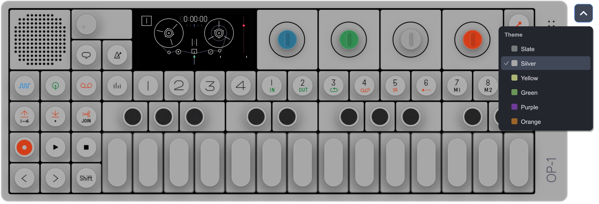
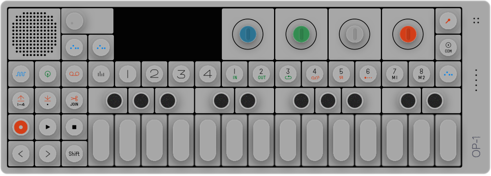
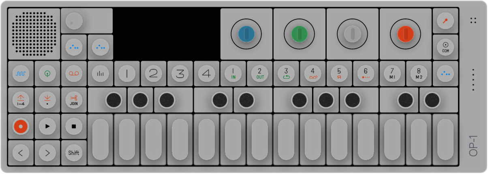
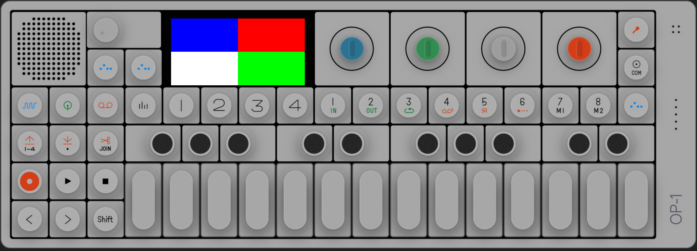
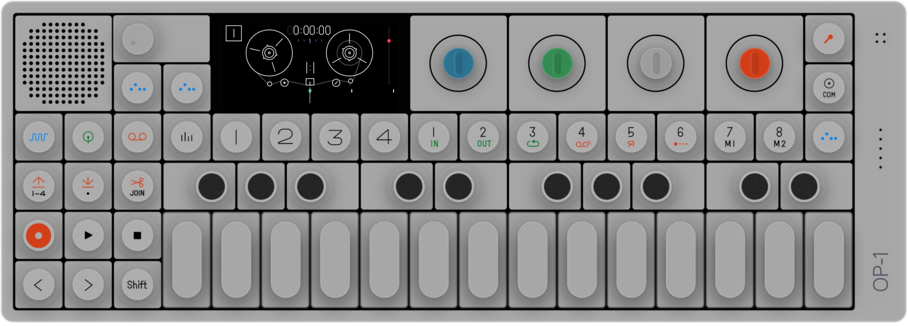

# SVG frontend verification, 2026-10-28

The user approved the current implementation for upstream review on 2026-10-29.
The latest preview includes the supplied `op-skew.svg`, six live palettes and the
dropdown beside the upper-right body corner. Review and broader firmware/desktop
compatibility validation remain outstanding; no merge is authorized.




The palette sheet uses blank screens. The live screenshot is firmware 246 at
normal playback speed; no firmware, NAND, OTP or private inputs are included.
See [theme usage and validation](../../../gui/themes/README.md).

These measurements and images record the original frontend verification.
The later theme experiment uses the improved `op-skew.svg`; see the
[artwork and theme record](../../../gui/themes/README.md). The historical
comparisons below have not been regenerated against that later export.

Baseline source: the user's replacement `/Users/javi/Downloads/op1.svg`, explicitly
approved for public redistribution. The earlier handoff's `op-skew(1).svg` was
superseded. The baseline `gui/op1.svg` SHA-256 was:
`4a2a4694e251d8295bf6af198d5ec1c6187f38ffc77a493a58eb0fea50ef9de5`.
The original bytes, all 217 filters, gradients, masks and internal references
are retained. No external resources, embedded screenshot or static screen content
were found, so no derivative was necessary. Intrinsic size/viewBox is 1204 × 434,
with no perspective transform on the screen. No Figma reference was provided;
Inkscape is the independent reference here.

The blank screen rectangle is x=282.227, y=20.7792, w=258.784, h=126.956.
The live 2:1 framebuffer is placed at x=295.5, y=32, w=231, h=115.5, with
the whole framebuffer inside the recess. The user's hardware photograph was
aligned by the recess corners; the track-number outline and tape-reel centers
were compared to the emulator capture. A subsequent marked reference requested
a lower tape-playhead endpoint. The user chose to keep the full framebuffer
visible after seeing that an exact match would crop its bottom. This placement
enlarges the photo-calibrated image by 3.1%, retains its top position and stays
just inside the bottom of the glass. The playhead endpoint remains above the
marked target; no source pixels are cropped or stretched. This is a visual
calibration, not a physical display measurement. Screen quads also support
perspective transforms (covered by the GL harness).

The SVG layout selects `display.filter: "linear"` to smooth the live firmware
pixels during scaling. `"nearest"` remains selectable and is the default when
the field is omitted, including the PNG fallback. This affects texture sampling
only; framebuffer dimensions, RGB565 data, rotation, screen quad and input
coordinates are unchanged. The GL regression magnifies a 2x2 diagnostic frame,
checks the interpolated center, then switches to nearest without a new frame
upload and verifies the original colors and display-texture reuse.
Local validation passed all 22 CTests in the SVG build and the OpenGL harness
in both SVG-enabled and PNG-only builds, including the filter-switch checks.

The optional `--floating-ui` mode removes the window decoration and clears the
background transparently, retaining the SVG's alpha at its rounded corners.
Unbound casing drags move the window; all buttons, encoders and volume regions
retain their input. Escape restores the normal window; Cmd/Ctrl with `+`/`-`,
`M` or `W` resizes, minimizes or closes it. The framed UI remains the default,
and missing SVG/transparency support falls back to it. Local macOS checks passed
transparent-corner/opaque-body readback, all 58 buttons, encoder/volume input,
native window movement, aspect-preserving resize, close and frame recovery.
CI runs the floating harness too; without desktop transparency it explicitly
checks the framed fallback. Live firmware reached the Tape screen in this mode.

## Reference comparisons

Inkscape 1x / resvg 0.49.0 1x:




[Inkscape 2x](inkscape-2x.png) · [resvg 2x](resvg-2x.png)

The panel, knobs, blurred shadows, displaced textured keys and outlined labels
remain present in both renderers. Close inspection shows small differences in
filtered edges and fine noise. This is not a pixel-identical renderer match.
No material missing effect or alpha halo was observed, so no filter or artwork
adjustment was made.

Mean absolute RGB channel difference (0..255), composited against an opaque
background; includes the full image, so flat regions lower the average:

| Density | White background | Dark (#1f1f1f) background | Maximum channel difference, white |
| --- | ---: | ---: | ---: |
| 1x, 1204×434 | 1.5784 | 1.7009 | 90 |
| 2x, 2408×868 | 1.0833 | 1.0686 | 42 |

These measurements describe this file and tool versions, not a general fidelity
guarantee. The GL test separately checks half-alpha green over the clear color,
which would fail with straight-alpha blending of resvg's premultiplied bytes.

## Emulator shell captures

SVG on the local Retina display, 2408×868 physical pixels:



[Original PNG shell on Retina](png-shell-retina.png), 3960×1424 physical pixels.
The colored screen is a diagnostic RGB565 framebuffer, not firmware UI. These
captures establish composition/rotation, not successful firmware boot.

## Reproduce

From the repository root after the README's build commands:

```sh
inkscape gui/op1.svg --export-type=png --export-filename=inkscape-1x.png
inkscape gui/op1.svg --export-type=png --export-width=2408 --export-filename=inkscape-2x.png
./build/op1-svg-render gui/op1.svg 1204 434 resvg-1x.png
./build/op1-svg-render gui/op1.svg 2408 868 resvg-2x.png
./build/op1-ui-preview --test
./build/op1-ui-preview gui/ui-svg.json svg-shell-retina.png
./build/op1-ui-preview gui/ui.json png-shell-retina.png
```

Local host: macOS arm64, AppleClang 17, LLVM 15.0.7, Rust 1.91.1.
SVG-enabled build and all 22 firmware-free CTests passed. The local socket test
requires host socket access; its initial restricted run failed to connect, then
passed with that access. `--help` passed. Raster tests check invalid/missing
files, sizes, viewBox, aspect fit, premultiplied alpha, blur and seeded
noise/displacement. Input tests check all 58 buttons, all encoder directions,
GPIO preservation, release-outside, focus loss, simultaneous keyboard/mouse
holds, volume saturation and geometry transforms. GL tests check odd-width
RGB565 rows, rotation, projective quads, texture reuse, resizing, PNG reuse and
blend/unpack state restoration. Missing-config runtime fallback was also captured.

The existing Python profiling suite is Linux-specific (`os.sched_getaffinity`):
on local macOS it produced 125 passed, 56 failed, 2 errors, chiefly because that
API is unavailable. It remains assigned to Linux in CI; its sources were not
changed by this work.

The first verification used synthetic frames. A subsequent explicitly authorized
local firmware-246 session verified actual boot and representative live controls
(see below). CI platform results are recorded in PR #6. Linux CI runs the full GL harness
under Xvfb. The hosted macOS VM passed the SVG build and all 22 CTests but
could not create a GLFW OpenGL window; CI now probes this capability and
explicitly reports the GL runtime check as unavailable in that environment.
Actual macOS GL assertions and the Retina captures passed on the local arm64
desktop. No renderer assertion failure is converted into a context skip.
The current implementation was subsequently approved by the user for upstream review.


## Live firmware follow-up

After the user supplied [PR #3](https://github.com/GosuBoy/op1emu/pull/3) as a
loading reference and explicitly approved execution, existing local inputs were
found and tested. The Downloads LDR matched the locally recorded canonical
plaintext firmware-246 hash.
The existing provisioned golden NAND was opened with `--nand-snapshot`, and a
separate byte-identical OTP copy was used in a private temporary run directory.
The source NAND, LDR and OTP hashes were checked after clean shutdown and were
unchanged. No firmware, NAND, OTP or private research files are committed.

The Release binary was placed in a temporary macOS `.app` bundle solely so the
desktop capture/control tool could select it. Both the plain executable and
bundled executable booted. Runtime options were `--ui=svg --nand-snapshot
--deterministic`; the latter makes guest playback faster than wall time.

The live test exposed a native window-sharing input issue: GLFW cursor-position
events correctly followed the synthetic pointer, but `glfwGetCursorPos` returned
the same stale global position for different clicks. Hit testing now uses the
latest cursor event, with a query fallback before the first event and cache
invalidation on focus loss. Temporary diagnostic logging was removed. A GL
regression invokes the cursor/button callbacks with independent event coordinates
and verifies Synth GPIO press, release outside and focus invalidation.

Observed live results:

- Firmware boot reached the Tape screen; the live RGB565 content was upright,
  sharp and aligned with the SVG bezel.
- Synth, Tape and Drum clicks changed the firmware UI. The window was resized
  during the session; the screen and controls stayed aligned.
- Play changed the icon and advanced the tape counter; Stop cleared Play and
  held the counter.
- Clockwise blue encoder steps changed the Drum parameter from `F2 +0` to
  `F2 +1`; counterclockwise steps restored `+0`.
- Both directions of all four encoders, all four encoder pushes, Shift (mouse
  and keyboard modifier), volume up/down and a press/drag/release outside were
  exercised. Not every action has an independently measured firmware parameter;
  exhaustive GPIO/volume-state assertions remain the automated tests' coverage.
- The host audio device initialized successfully. Audible correctness, latency,
  exhaustive note combinations and physical-device behavior were not measured.

The user explicitly authorized publication of this updated live firmware-246
Tape preview in the floating window, with calibrated placement and bilinear smoothing:



This earlier preview predates the improved artwork and theme dropdown shown at
the top. The user has now approved the current implementation for upstream review.
Earlier published Drum and framed Tape images predate the floating window;
other live captures remain private.
The color-screen captures are firmware-free diagnostic images.
