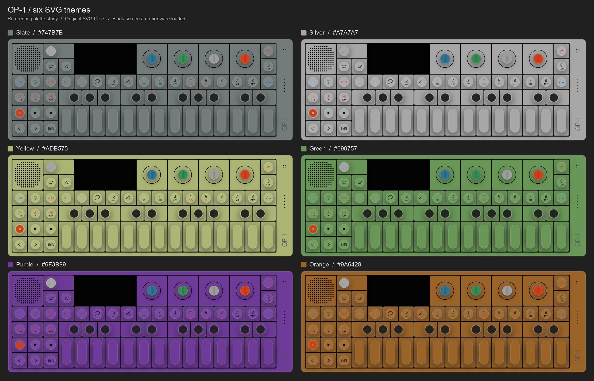

# SVG themes

The six-theme implementation is included in [upstream PR #77](https://github.com/op1emu/op1emu/pull/77).
It was developed on `experiment/svg-themes`, which remains a rollback checkpoint.
Palettes were sampled from the user's six-panel reference; Silver is an exact
rendering baseline for the supplied SVG.



| Theme | Surface color |
| --- | --- |
| Slate | `#747B7B` |
| Silver | `#A7A7A7` |
| Yellow | `#ADB575` |
| Green | `#699757` |
| Purple | `#6F3B99` |
| Orange | `#9A6429` |

Run from the repository root with SVG support enabled:

```sh
./build/op1emu nand.bin --ui=svg --floating-ui --theme=green
./build/op1-ui-preview --floating --theme=green gui/ui-svg.json
```

The second command uses a synthetic four-color framebuffer and needs no firmware.
Click the dropdown button just outside the SVG body's upper-right corner to
open the six-theme selector. The former right-click selector has moved here.
Each item has a color swatch and the active preset has a checkmark. Click to
select, or use Up/Down and Enter. Tab focuses the button and Enter/Space opens it.
Escape, an outside click, a second button click, or focus loss
dismisses the menu. In floating mode Escape dismisses an open menu first, then a
subsequent Escape restores the title bar. The selection lasts for the current
session; there is no saved preference yet.

Omitting `--theme` uses the original SVG. A bad/missing startup theme
reports its error and recovers to original SVG colors. The PNG panel reports
that themes are unavailable and retains its original colors.

Copy a palette JSON and pass its path with `--theme path/to/custom.json`. Version
1 requires four `#RRGGBB` colors: `body`, `panel`, `keycap`, and `encoder-ring`.
The presets assign the same base color to each surface, matching the reference,
but custom files can set each independently. Colored encoder caps, the volume
knob, black keys, labels and the live firmware display keep their existing paint.

The latest user-supplied `op-skew.svg` is stored byte for byte as
`gui/op1.svg` (SHA-256 `8af5c1c4ec44c7601763c4c4d02f0a558378531dc998cc8428d7081da5407f29`).
It retains the corrected speech-bubble and metronome artwork and supersedes
`op-skewmorphism.svg`. The volume panel's fill rectangle, highlight rectangle
and filter region move one SVG pixel to the right. No other XML attributes or
elements change. The 1204 × 434 viewport, knob geometry, screen quad, control
regions and filter operations still apply without adjustment.
The revised export passed the four targeted raster/theme/layout CTests and the
floating/menu harness, including all six live palette changes and all 58 button
mappings. The running firmware session loaded the improved icons through the
theme menu without restarting.

`gui/op1-themeable.svg` is a
class-only derivative: one body, 60 panels, 54 keycaps/rims and four encoder rings.
resvg 0.49.0 applies the palette through its stylesheet option before parsing.
The parsed tree and physical-resolution texture use the existing cache. There
is no per-frame recoloring. Runtime selection renders a replacement tree/texture
on a worker while the previous background remains visible. The main thread swaps
it in when ready, reusing the window and background GL texture; firmware pixels,
input mappings and audio are not restarted. A failed switch keeps the current
theme, and rapid selections use the latest requested palette. The menu stays
inside the window, anchored beneath the button, and its text raster follows
physical framebuffer density. A 64-unit transparent margin holds the 40-unit
button, 12 units beyond the body and eight below its top. Initial SVG body size
is preserved; the floating aspect includes the margin and all rendering/input
coordinates use the shared body fit. The PNG layout gains no margin or button.
Geometry, screen coordinates, controls, gradients
and all 217 filters are shared with the original artwork.

Regenerate or audit the derivative (Python standard library only):

```sh
python3 tools/prepare_theme_svg.py
python3 tools/prepare_theme_svg.py --check
```

The generator checks the original artwork's SHA-256 and paint counts. A new
source export requires reviewing the assignments before updating that guard.

Render the local comparison with Pillow installed in the selected Python:

```sh
cmake --build build --target op1-svg-render
python3 tools/compare_svg_themes.py
```

Outputs go to `build/visual-comparisons/themes/`: six transparent PNGs at each of
1x and 2x, and `six-themes-comparison.png`. The sheet uses actual resvg renders
with blank screens; it contains no firmware image. Pillow is needed only to
assemble this review sheet.

Regression coverage checks palette validation, independent surface assignments,
pixel-identical silver/unthemed derivative at 1x and 2x, identical alpha across
all six themes, unchanged screen and encoder-cap pixels, and dark black-key
centers. The OpenGL harness clicks all six dropdown items, checks the active row,
keyboard/outside/focus dismissal, prevention of accidental instrument input,
fresh RGB565 uploads during worker jobs, texture/window reuse, rapid selections
and recovery from a missing palette. It also checks button placement outside the
body, menu anchoring/toggling, transparent unused margin, quarter-size fitting,
and the unchanged instrument GPIO events. Original PNG/build-disabled checks remain
available without Rust.

Local macOS arm64 validation: 24/24 SVG-build CTests passed (the loopback socket
test was rerun with network access); all four PNG-only UI/theme CTests passed.
Both builds passed normal and floating/fallback OpenGL harnesses. The SVG runs
started in Purple/Green and verified all six palettes with the diagnostic screen.

The menu update also passed the four targeted raster/theme/layout CTests and the
normal/floating OpenGL harnesses on local macOS, including the PNG-only build's
normal and floating-request fallback checks.

A live firmware-246 session also accepted Yellow, Slate, Orange, Purple and
Silver selections without restarting the emulator process. Native screenshots
confirmed the background changed while the live Tape screen stayed in place.
For a reproducible firmware-free popup image, set `OP1_UI_MENU_CAPTURE` to a PNG
path when running `op1-ui-preview --test` (the destination directory must exist).

The dropdown-location revision passed the four targeted raster/theme/layout
CTests plus normal/floating SVG and PNG-fallback OpenGL checks on macOS. A native
firmware-window capture verified the button beside the upper-right body corner,
with the same six choices opening beneath it. All 58 controls and the live screen
retain their mapping with the added transparent margin, including after resizing.
